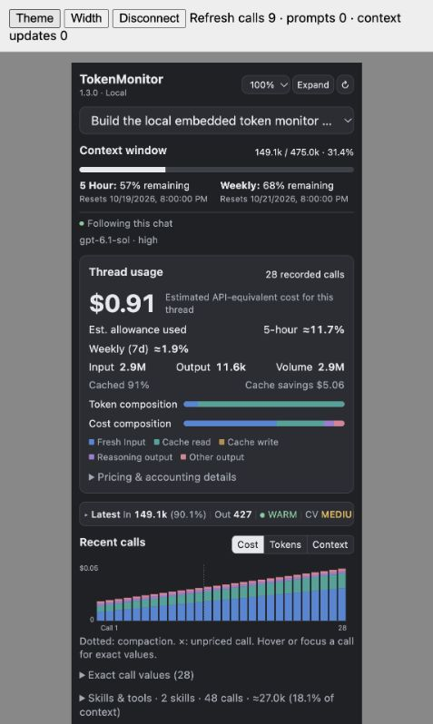

# TokenMonitor

Token usage, context capacity, cache behavior, and account allowances inside Codex.
TokenMonitor Embedded opens an interactive panel once per chat and refreshes locally
while visible, without additional model turns or API keys.

[Releases](https://github.com/ACB-prgm/TokenMonitor/releases/latest) ·
[Report a bug](https://github.com/ACB-prgm/TokenMonitor/issues) ·
[Development](CONTRIBUTING.md)

## Features

- Latest-call cached, fresh, input, output, and reasoning tokens.
- Context capacity, five-hour and weekly account allowances, and reset times.
- Thread API-equivalent cost, cache savings, and pricing coverage.
- Recent-call charts, compaction markers, cache temperature, and tool attribution.
- Per-panel task selection, light/dark themes, adjustable scale, and compact view.
- Bundled Node runtime and Swift collector; no runtime downloads or external telemetry.



Preview of the production UI in the local MCP Apps test host, using synthetic
demonstration data. It contains no private conversations or account telemetry.
The old floating native HUD is retired; see [migration guidance](DEPRECATION.md).

## Compatibility

The prebuilt package supports **Apple silicon Macs, macOS 13.5 or later**, with
Codex desktop's local plugins, MCP Apps panel, and reviewed command hooks.
The tested host is **Codex 0.163.0-alpha.10.2**. Later builds may change transcript
formats or plugin behavior; they are not automatically certified.

Windows, Linux, Intel Macs, browser/mobile clients, and a standalone CLI panel
are unsupported. The CLI manages installation; the desktop client renders the UI.
Connected remote execution has been reported working by the maintainer but is not
independently certified for this public release. Install on each execution Mac.
The compatibility manifest is deliberate: the tested host discovers its hooks,
whereas a root Agent Plugins manifest suppressed them during earlier tests.

## Installation

Use the **prebuilt release**, which includes the actual server, UI, Swift collector,
Node runtime, license notices, and a local marketplace. You need the Codex CLI
available as `codex`; you do not need Node, Python, Xcode, or an OpenAI API key.

Download `token-monitor-VERSION-macos-arm64.zip` and its `.sha256` file from
[the latest release](https://github.com/ACB-prgm/TokenMonitor/releases/latest).
For version 1.3.0:

```sh
curl -fLO https://github.com/ACB-prgm/TokenMonitor/releases/download/v1.3.0/token-monitor-1.3.0-macos-arm64.zip
curl -fLO https://github.com/ACB-prgm/TokenMonitor/releases/download/v1.3.0/token-monitor-1.3.0-macos-arm64.zip.sha256
shasum -a 256 -c token-monitor-1.3.0-macos-arm64.zip.sha256
mkdir -p "$HOME/Applications/TokenMonitor/1.3.0"
unzip token-monitor-1.3.0-macos-arm64.zip -d "$HOME/Applications/TokenMonitor/1.3.0"
codex plugin marketplace add "$HOME/Applications/TokenMonitor/1.3.0/TokenMonitor"
codex plugin add token-monitor-embedded@tokenmonitor
```

Keep that version directory for updates and rollback. Open the desktop Plugins
Directory, choose **TokenMonitor**, and confirm **TokenMonitor Embedded** is installed
and enabled. Restart Codex if the source is not visible. Review and trust its six
hooks in Settings → Hooks, then start a fresh chat. Ask “Open TokenMonitor” if it
does not open automatically. First-prompt opening requires the model to follow the
hook instruction. Installing a plugin does not grant hook trust.

The binaries are ad-hoc signed and **not notarized**. Respect macOS security prompts;
this project does not remove quarantine or bypass Gatekeeper.

Do not use `codex plugin marketplace add ACB-prgm/TokenMonitor --ref main` as an
end-user installation: the Git source excludes compiled assets, and marketplace
installation does not build them. The release contains a complete local marketplace.
Universal public-directory listing is a separate review process and is not claimed.

## Updating and rollback

Download and verify the next release, extract to its own version directory, then
repeat the marketplace-add and plugin-add commands using that directory. If your
host refuses to replace the local source, run `codex plugin marketplace remove
tokenmonitor` first, then add the new version's directory. Start a fresh chat and
review changed hooks. Do not delete monitor state during an update.

The same procedure with a previous release rolls back. Historical release assets
remain available. Close old panels to avoid using a previous running connection.

## Uninstallation

```sh
codex plugin remove token-monitor-embedded@tokenmonitor
codex plugin marketplace remove tokenmonitor
```

You can then delete the extracted version directories. Monitor metadata remains in
`${CODEX_HOME:-~/.codex}/token-monitor-embedded`; host-managed plugin data may also
contain an extracted runtime. Remove retained data only if you explicitly want to
reset it. Codex conversation logs are owned by Codex and are never deleted by this
plugin. Removing Embedded does not uninstall a legacy native HUD; use its own
[uninstaller](DEPRECATION.md).

## Usage and interpretation

Enable reviewed hooks and send a prompt in a new chat. The panel refreshes every
two seconds while visible; refreshes do not send prompts. Choose a local task to
inspect its recorded usage. Host identity is used only after validating the exact
session; fallback follows valid hook events, including background completions.

**Input already includes cached input. Fresh = input − cached.** Reasoning is
included in output. Missing telemetry displays an em dash. Context is observed
usage, not a forecast. Cost is an API-equivalent estimate using the bundled rate
table, not a subscription bill. Thread allowance estimates use fixed calibrations
and lifetime thread cost; they are not measured rolling-window account usage.
Tool attribution and compaction recommendations are approximations.

[Detailed behavior and assumptions](plugins/token-monitor-embedded/README.md)
include pricing coverage, partial histories, fork limits, and reset semantics.

## Development

Requires Apple silicon macOS, Swift/Xcode, Node 24, and Python 3 for build tooling.
SwiftUI/AppKit native sources remain for shared telemetry and legacy cleanup;
the supported UI is React/TypeScript served by a local stdio MCP server.

```sh
swift test
python3 scripts/test_hooks.py
cd plugins/token-monitor-embedded
npm ci --ignore-scripts
npm run build
npm run typecheck
npm test
cd ../..
python3 scripts/check-release.py
python3 scripts/build-release.py
python3 scripts/test_embedded_archive.py
python3 scripts/test_embedded_hook_discovery.py
python3 scripts/test_release_install.py
```

The release builder downloads only the pinned official Node archive at build time,
verifies its SHA-256, and bundles it. `VERSION` is authoritative; use
`python3 scripts/set-version.py X.Y.Z` to synchronize active package/UI metadata.
The retired native manifest keeps its historical version.

## Releases and maintenance

[CHANGELOG.md](CHANGELOG.md) records releases. Public versioning starts at **1.3.0**
to follow the historical native 1.2.0 and embedded 0.3.5 versions without reusing them.
Development follows `feature/* → dev → tested PR → main → annotated vX.Y.Z tag →
GitHub Release`. Small changes may go directly to dev. Tags run the release workflow;
dev commits do not publish. [CONTRIBUTING.md](CONTRIBUTING.md) covers patches,
features, breaking changes, emergency fixes, and rollback.

## Privacy and data handling

Processing stays on the execution Mac. The collector reads Codex telemetry and
schema-checked task metadata without editing transcripts or databases. Task IDs,
derived titles, workspace basenames, and aggregates reach the panel in UI-only
metadata. Raw transcripts, prompt text, and full source paths remain in the collector.
The panel can reveal task context; consider that before sharing a screenshot.

Startup uses one model-visible instruction per chat. The diagnostic routing recorder
is off by default. No external analytics, uploads, cloud services, credentials, or
pricing requests are introduced. Local metadata and runtime caches persist across
updates. Codex's transcript format is not a stable public telemetry API.

## License

Original TokenMonitor code is licensed under **PolyForm Noncommercial License 1.0.0**
(`PolyForm-Noncommercial-1.0.0`); see [LICENSE](LICENSE) and [NOTICE](NOTICE).
It is free for personal and other uses permitted by the license. You may modify and
redistribute it within those terms. Commercial use requires separate authorization
from the copyright holder unless otherwise permitted by the license.

Public source availability does not make this OSI-approved open source. Third-party
components retain their respective licenses; release packages include their notices.
TokenMonitor is independent of OpenAI.

## Bug reports and contributions

[Open an issue](https://github.com/ACB-prgm/TokenMonitor/issues) with the release,
macOS and Codex versions, expected behavior, and reproduction steps. Redact task
titles, paths, and account details; do not upload raw conversations, credentials,
or your Codex data directory. Read [CONTRIBUTING.md](CONTRIBUTING.md) before a PR.
